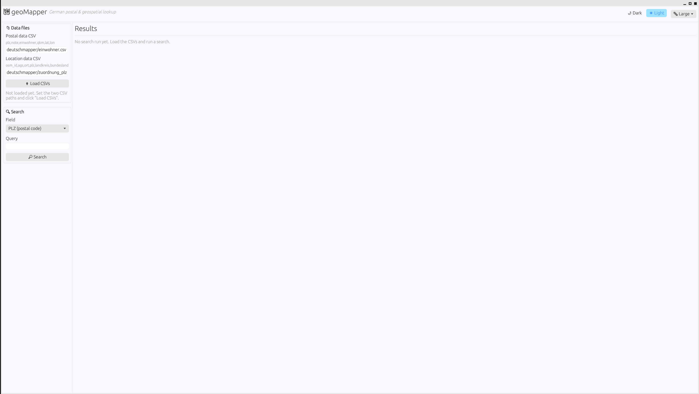

# geomapper GUI

`src/bin/gui.rs` is a desktop egui/eframe front-end for the same two CSV
files the CLI (`src/main.rs`) uses. Run it with:

```
cargo run --bin gui
```

or after building:

```
./target/debug/gui        # or target/release/gui after `cargo build --release --bin gui`
```





## Using it

1. In the left panel, check/adjust the two CSV paths (defaults assume you
   run it from the project root, pointing at
   `deutschmapper/einwohner.csv` and `deutschmapper/zuordnung_plz_ort.csv`).
2. Click **Load CSVs**.
3. Pick a search field from the **Field** dropdown (mirrors the CLI's
   subcommands: PLZ, Note, Einwohner, Qkm, Latitude, Longitude, OSM ID,
   AGS, Ort, Landkreis, Bundesland, General pattern).
4. Type a query and click **Search** (or press Enter).
5. Results show up as a table on the right. PLZ searches show both the
   postal-data table and the location-data table, matching the CLI's
   `plz` subcommand.

Numeric/code fields (PLZ, Einwohner, Qkm, Latitude, Longitude, OSM ID,
AGS) are matched **exactly**. Free-text fields (Note, Ort, Landkreis,
Bundesland, General pattern) are matched **case-insensitively as a
substring**, which is friendlier for a GUI than the CLI's exact-match
behaviour.

Gaurav Sablok \
gsablok@proton.me
